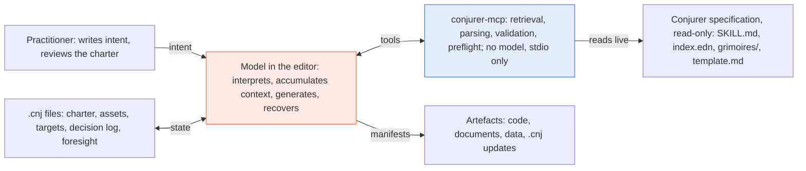
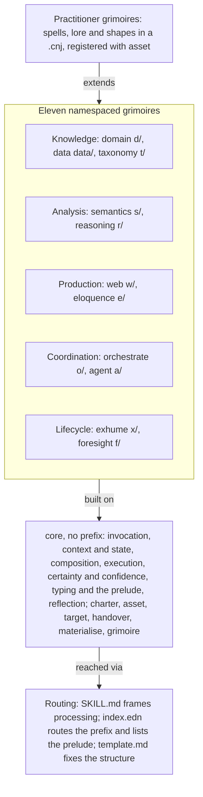
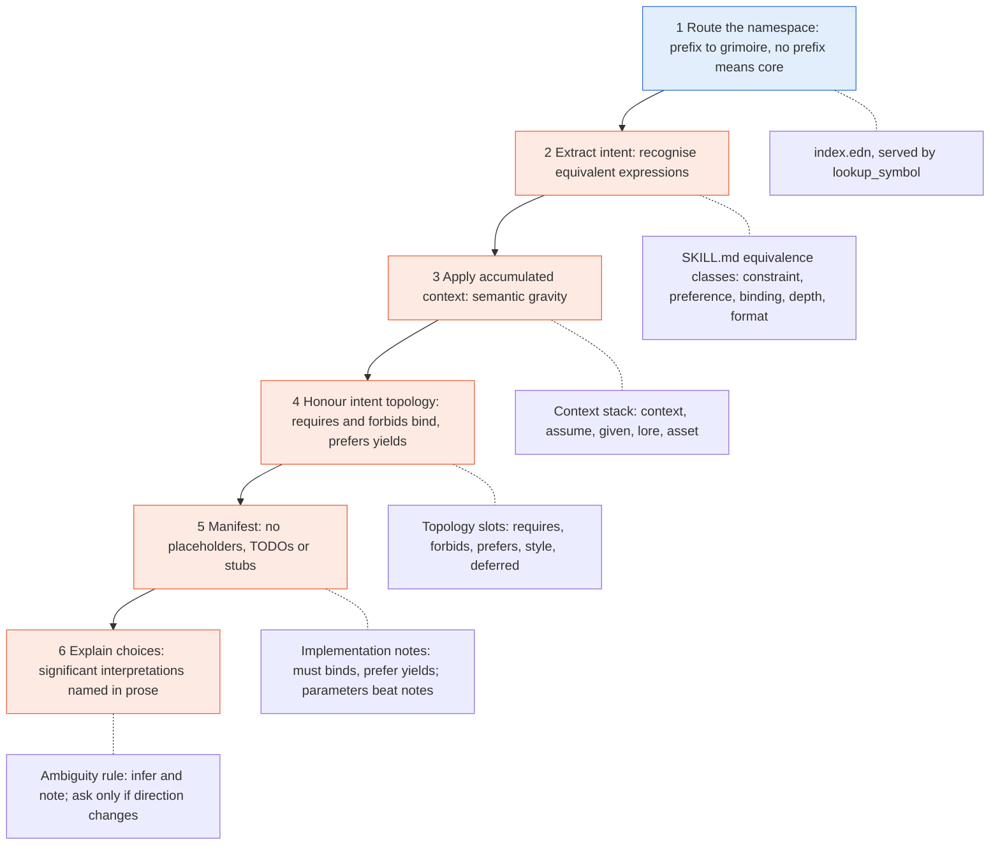
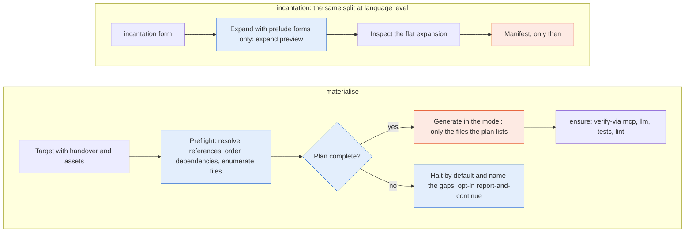
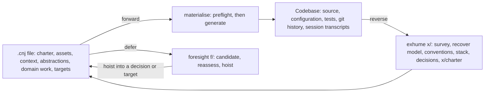
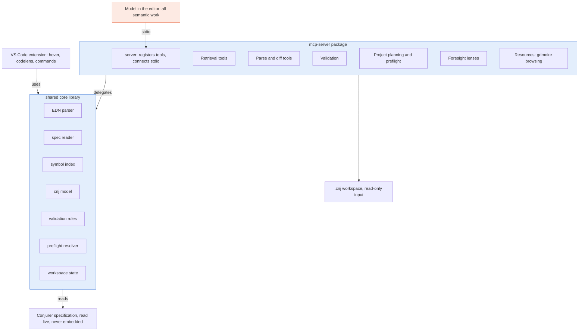

# Conjurer architecture

*A high-level overview: how the specification, the processor and the tooling
divide the work, and how a project moves between intent and artefact.*

Conjurer splits all work along one line: a deterministic plan on one side, a
semantic act on the other. The specification is read-only text. A
deterministic processor — in practice the conjurer-mcp server — owns
retrieval, parsing, validation, preflight and the evaluation of prelude
forms. The model that interprets Conjurer, resident in the practitioner's
editor, owns everything semantic: interpretation, manifestation, generation
and recovery. This document draws that division; the specification itself
lives in [`conjurer.md`](conjurer.md), [`grimoires/core.md`](grimoires/core.md)
and [`template.md`](template.md).

---

## Vocabulary

The terms map onto two axes: what a practitioner writes (invocation, charm,
spell, incantation, grimoire) and what happens to it (manifestation,
preflight, materialise, handover).

| Term | What it is | Character |
|---|---|---|
| invocation | any form `(head name :params)`; no prefix means core | the unit everything else is made of |
| charm | anonymous invocation, as `fn` is to `defn`; convenience, not capability | semantic |
| spell | named, parameterised, reusable invocation; defining one manifests nothing; context is captured at the call site | semantic |
| incantation | macro: an invocation that generates invocations, using prelude forms only; may not generate incantations, so every preview stays flat | expansion deterministic, execution semantic |
| prelude | the closed list of expression forms a deterministic processor may evaluate; every other head is a semantic function | deterministic |
| grimoire | namespace plus its constructs; the twelve standard grimoires are frozen, practitioner grimoires are `.cnj` files registered with `asset` | static text |
| manifestation | the act of turning intent into an artefact (`conjure` creates, `refine` enhances, `transmute` changes form) | semantic |
| preflight | first half of `materialise`: resolve references, order dependencies, enumerate files; nothing is generated | deterministic |
| materialise | turns a `target` into an artefact in two phases: preflight, then generation | split |
| handover | structured context object for another agent or session, serialised in full; explicitly not a prompt | assembly deterministic, use semantic |
| `.cnj` file | the project's persistent memory: charter first, append-only decision log with identifiers, materialisation plan, foresight backlog | static text |

---

## The determinism boundary

Everything mechanical about the specification and the `.cnj` files belongs to
a deterministic processor; everything that interprets meaning belongs to the
model. conjurer-mcp holds the line by design: it embeds no model, and it
speaks only stdio.

| Part | Character | Runs in | Rule that holds it there |
|---|---|---|---|
| Spec files: `SKILL.md`, `index.edn`, `grimoires/`, `template.md` | static | the repository, read live | read-only; never embedded in a build |
| EDN parsing of `.cnj` and `index.edn` | deterministic | conjurer-mcp | same input, same syntax tree |
| Symbol routing: prefix to grimoire | deterministic | conjurer-mcp | `index.edn` is the routing layer |
| Validation | deterministic | conjurer-mcp | pure rules, authored and recovered modes |
| Dependency graph, topological order, references | deterministic | conjurer-mcp | names resolve as symbol or keyword; references by kind (`:decision/...`, `:target/...`) |
| Materialise preflight | deterministic | conjurer-mcp | halts on unresolved references by default |
| Prelude evaluation, incantation expansion | deterministic | any deterministic processor | only forms listed under `:prelude` in `index.edn` |
| Intent extraction, equivalence classes, semantic gravity | semantic | the model | interpret intent, not syntax |
| Intent topology and certainty qualifiers | semantic | the model | `:requires`, `:forbids` and `certain` bind; `prefer` yields and the yielding is surfaced |
| Execution primitives | semantic | the model | performed when they stand alone; generated as behaviour when inside a manifestation |
| Generation (second phase of `materialise`) | semantic | the model | only files the plan enumerates |
| `exhume` recovery | semantic | the model, with conjurer-mcp as deterministic input | every claim graded `:attested`, `:strongly-inferred` or `:speculative` |
| `ensure` postconditions | split | named by `:verify-via` | `:structural` is mechanical when written in the prelude, `:semantic` is the model, `:behavioural` is tests |

Certainty enforcement follows the same split in three layers: MCP-level
(truly deterministic where a structural checker exists for the artefact),
LLM-level (semantically binding at the client) and target-level (generated
tests, linters and schema validation). Core calls this the honest grammar of
certainty: a construct may not claim a layer it cannot reach.

---

## System at a glance

The model calls conjurer-mcp's tools, conjurer-mcp only reads the
specification, and only the model writes artefacts; the practitioner works
through the model and the `.cnj` files. Blue is deterministic, orange is
semantic.

---

## The specification stack

The standard library is frozen; growth goes into practitioner grimoires. The
five groups inside the namespaced layer are a reading aid, not a grouping the
specification declares.

---

## Processing an invocation

Only routing is mechanical. When layers disagree, explicit parameters beat
implementation notes and notes beat inferences from examples; `SKILL.md`
frames all of it. A conflict between two binding items is surfaced to the
practitioner, never silently resolved.

---

## Plan before act

The same discipline appears twice: `materialise` separates a repeatable plan
from generation, and `incantation` separates an inspectable expansion from
execution. Generating against an unresolved reference is treated as the
code-generation form of a fabricated rationale.

---

## The round trip

The `.cnj` file is the hub every flow passes through. Exhume emits Conjurer
specification rather than a report, grading each recovered claim. A hoisted
candidate lands as a charter decision with its own `:id`, or as a `target`,
and `f/hoist :into` names it (`:decision/<id>`, `:target/<name>`).

The reverse flow is also the way out of free exploration: a prototype built
by conversation, with nothing specified in advance, is exhumed — its decisions
from the session transcripts where they survive — and crystallised into a
charter the forward flow continues from (`grimoires/exhume.md` ·
*Crystallising an exploratory prototype*).

---

## conjurer-mcp

Tool modules only register and delegate; all logic sits in a shared core
library, which the VS Code extension uses as well, so the parser and the
types exist once. stdio is the only transport. The server is a separate
repository and evolves on its own schedule; where the specification has moved
ahead of it — the prelude evaluator, keyword and symbol names as one name,
reference keywords by kind, a candidate's current status read from its
`:history` — the specification is the authority and the server follows.

---

*For the language itself, continue to [`grimoires/core.md`](grimoires/core.md);
for the philosophy behind this division, to [`conjurer.md`](conjurer.md).*
